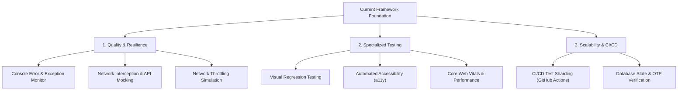

# 🚀 Playwright Framework Enhancement Plan: What Else Can Be Added

This document outlines high-impact architectural enhancements and best-practice features recommended for scaling this Playwright + TypeScript automation framework to enterprise production standards.

---

## 📌 Executive Summary

Our current framework provides a strong foundation with:
- **Strict Page Object Model (POM)** with private locators and public action methods.
- **Two-Tier Hierarchical Step Reporting** combining human-readable business actions and assertions.
- **Hybrid Zero-Boilerplate Allure Reporting** with test-data-driven titles and tags.
- **Cross-Browser Matrix** (Chromium, Firefox, WebKit) with shared authentication session caching (`storageState`).
- **Resilient Waiting Engine** (`BasePage` explicit waits + `PollHelper` eventual-consistency polling).

To further evolve this framework for large-scale test suites (500+ tests, multiple squads, high-frequency CI/CD), the following additions represent the most valuable industry-proven capabilities.

---

## 🏗️ Recommended Framework Enhancements



---

## 1. Quality & Resilience Enhancements

### 1.1 Browser Console Error & Exception Listener
* **What it is**: Automatically hooks into browser events (`page.on('pageerror')`, `page.on('console')`) to detect unhandled JavaScript errors, uncaught promise rejections, and `500 Internal Server Errors`.
* **Why it helps**: Many frontend bugs break user experience (e.g. broken analytics, broken third-party scripts, React error boundaries) without immediately failing DOM element assertions.
* **Implementation Blueprint**:
```typescript
// fixtures/test.fixture.ts or hooks
test.beforeEach(async ({ page }, testInfo) => {
  const consoleErrors: string[] = [];

  page.on('pageerror', (exception) => {
    consoleErrors.push(`[Unhandled Exception] ${exception.message}\n${exception.stack}`);
  });

  page.on('console', (msg) => {
    if (msg.type() === 'error') {
      consoleErrors.push(`[Console Error] ${msg.text()}`);
    }
  });

  // Attach to Allure if errors were captured during execution
  testInfo.attach('browser-console-errors', {
    body: () => Buffer.from(consoleErrors.join('\n')),
    contentType: 'text/plain',
  });
});
```

---

### 1.2 Network Interception & Request Mocking (`page.route()`)
* **What it is**: Playwright's native capability to intercept network requests at the browser level, allowing tests to mock responses, modify headers, or simulate HTTP error codes (`500 Internal Server Error`, `429 Rate Limited`, `504 Gateway Timeout`).
* **Why it helps**:
  - Test failure and error-handling UX (e.g. payment gateway timeout, out-of-stock API error) without needing to corrupt staging databases.
  - Mock third-party external dependencies (Stripe, Google Analytics, Salesforce) to eliminate flakiness and third-party downtime.
* **Implementation Blueprint**:
```typescript
// utils/mock-helper.ts
export class MockHelper {
  // Simulate payment gateway failure
  static async mockPaymentFailure(page: Page): Promise<void> {
    await page.route('**/checkout/process-payment', async (route) => {
      await route.fulfill({
        status: 500,
        contentType: 'application/json',
        body: JSON.stringify({ error: 'Payment Processor Unavailable' }),
      });
    });
  }

  // Mock zero search results
  static async mockEmptyCatalog(page: Page): Promise<void> {
    await page.route('**/catalog/search*', async (route) => {
      await route.fulfill({
        status: 200,
        contentType: 'application/json',
        body: JSON.stringify({ products: [] }),
      });
    });
  }
}
```

---

### 1.3 Network Throttling / Slow Connection Simulation
* **What it is**: Emulates low-bandwidth environments (Slow 3G, Fast 3G, Offline mode) using Chrome DevTools Protocol (CDP).
* **Why it helps**: Verifies how the application behaves when loading states, skeleton loaders, and button disablement take several seconds. Prevents double-submission bugs.
* **Implementation Blueprint**:
```typescript
// utils/network-helper.ts
export class NetworkHelper {
  static async simulateSlow3G(page: Page): Promise<void> {
    const client = await page.context().newCDPSession(page);
    await client.send('Network.emulateNetworkConditions', {
      offline: false,
      latency: 400, // ms
      downloadThroughput: ((400 * 1024) / 8), // 400 kbps
      uploadThroughput: ((400 * 1024) / 8),
    });
  }
}
```

---

## 2. Specialized Testing Capabilities

### 2.1 Visual Regression Testing (Snapshot Comparison)
* **What it is**: Playwright's built-in pixel-by-pixel comparison tool (`expect(page).toHaveScreenshot()` or `expect(locator).toHaveScreenshot()`).
* **Why it helps**: Functional tests assert that an element exists; visual tests verify that the element **looks correct** (no misaligned CSS, broken responsive layout, overlapping buttons, or incorrect fonts).
* **Implementation Blueprint**:
```typescript
// tests/visual/home-visual.spec.ts
test('Verify home page visual appearance against baseline', async ({ homePage, page }) => {
  await homePage.open();
  // Masks dynamic elements (e.g. timestamps, carousels) to prevent false positives
  await expect(page).toHaveScreenshot('home-page-baseline.png', {
    mask: [page.locator('.dynamic-banner')],
    maxDiffPixelRatio: 0.02, // 2% tolerance
  });
});
```

---

### 2.2 Automated Accessibility (a11y) Audits
* **What it is**: Integrating `@axe-core/playwright` to scan pages against **WCAG 2.1 AA/AAA** accessibility standards during functional test runs.
* **Why it helps**:
  - Automatically flags compliance violations (low color contrast, missing `aria-label`, missing `alt` attributes, bad heading hierarchies).
  - Ensures legal compliance and accessibility without requiring separate manual audits.
* **Implementation Blueprint**:
```typescript
// utils/a11y-helper.ts
import AxeBuilder from '@axe-core/playwright';

export class A11yHelper {
  static async scanPage(page: Page): Promise<void> {
    const results = await new AxeBuilder({ page })
      .withTags(['wcag2a', 'wcag2aa'])
      .analyze();
    
    expect(results.violations).toEqual([]);
  }
}
```

---

### 2.3 Core Web Vitals & Performance Budget Assertions
* **What it is**: Capturing Chrome Performance metrics and Core Web Vitals (**LCP** - Largest Contentful Paint, **CLS** - Cumulative Layout Shift, **FID** - First Input Delay).
* **Why it helps**: Catch performance regressions in CI before releasing changes that degrade SEO rankings or user engagement.
* **Implementation Blueprint**:
```typescript
// utils/performance-helper.ts
export class PerformanceHelper {
  static async getPerformanceMetrics(page: Page): Promise<{ lcp: number; domLoaded: number }> {
    return await page.evaluate(() => {
      const timing = performance.getEntriesByType('navigation')[0] as PerformanceNavigationTiming;
      return {
        domLoaded: timing.domContentLoadedEventEnd - timing.startTime,
        lcp: 0, // Extracted from PerformanceObserver
      };
    });
  }
}
```

---

## 3. Scalability, Database & CI/CD Enhancements

### 3.1 CI/CD Sharding (Distributed Parallel Execution)
* **What it is**: Splitting the test execution across multiple parallel machines in GitHub Actions using Playwright's native `--shard=x/y` flag, then merging results into a unified Allure report.
* **Why it helps**: When your suite grows from 18 tests to 500+ tests, running sequentially or on a single machine takes 40+ minutes. Sharding across 4 runners cuts execution time to **under 8 minutes**.
* **GitHub Actions Matrix Blueprint**:
```yaml
# .github/workflows/playwright.yml
strategy:
  fail-fast: false
  matrix:
    shardIndex: [1, 2, 3, 4]
    shardTotal: [4]
steps:
  - name: Run Sharded Tests
    run: npx playwright test --shard=${{ matrix.shardIndex }}/${{ matrix.shardTotal }}
```

---

### 3.2 Database & OTP Verification Helper (`DatabaseHelper`)
* **What it is**: A backend client (PostgreSQL, MySQL, Redis, or Mongo) to query database state directly.
* **Why it helps**:
  - Fetch Two-Factor Authentication (2FA) / OTP codes directly from the database or Redis cache instead of waiting for external SMS/email APIs.
  - Reset test database fixtures before or after large test suites.

---

## 📊 Prioritization Matrix: Value vs. Effort

| Enhancement | Value / Impact | Implementation Effort | Recommended Phase |
| :--- | :--- | :--- | :--- |
| **Console Error & Exception Monitor** | 🔴 High | 🟢 Low (1 hour) | **Phase 1 (Immediate)** |
| **Network Interception / Mocking (`page.route`)** | 🔴 High | 🟡 Medium (2 hours) | **Phase 1 (Immediate)** |
| **Visual Regression (`toHaveScreenshot`)** | 🟡 Medium | 🟢 Low (1 hour) | **Phase 2 (Next)** |
| **Accessibility Audits (`@axe-core/playwright`)** | 🟡 Medium | 🟢 Low (1 hour) | **Phase 2 (Next)** |
| **CI/CD Test Sharding (GitHub Actions)** | 🔴 High | 🟡 Medium (2 hours) | **Phase 3 (Scaling)** |
| **Core Web Vitals Performance Capture** | 🟢 Low | 🟡 Medium (2 hours) | **Phase 3 (Scaling)** |
| **Database / Redis Verification Client** | 🔴 High | 🔴 High (Requires DB Access) | **Phase 3 (Scaling)** |

---

## 🎯 Next Recommended Steps
1. Add the **Console Error & Exception Listener** hook into `fixtures/test.fixture.ts` to automatically surface silent JavaScript errors in Allure reports.
2. Create `utils/mock-helper.ts` for negative API scenarios.
3. Configure **Visual Regression testing** for high-traffic pages (Home, Search, Cart).
